

  

  <a href="https://narpatganwliya7.github.io/Narpat_Ganwliya_Portfolio_narpatganwliya7.github.io/">🌐 Portfolio</a> ·
  <a href="https://www.linkedin.com/in/narpat-ganwliya">💼 LinkedIn</a> ·
  <a href="https://narpatganwliya7.github.io/Voice-of-the-Customer-AI/">🎧 Écoute live</a> ·
  <a href="mailto:narpatganwliya678@gmail.com">✉️ Email</a>

  

  

  

<table>
  <tr>
    <td width="33%"><a href="https://github.com/narpatganwliya7/Voice-of-the-Customer-AI">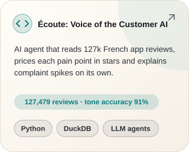</a></td>
    <td width="33%"><a href="https://github.com/narpatganwliya7/Resume-Optimizer-automated-CV-tailoring-pipeline">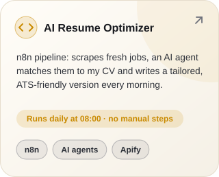</a></td>
    <td width="33%"><a href="https://github.com/narpatganwliya7/movie-recommender-system">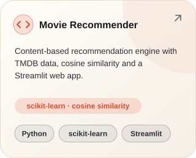</a></td>
  </tr>
  <tr>
    <td width="33%"><a href="https://github.com/narpatganwliya7/Blinkit-Sales-Analysis-Dashboard">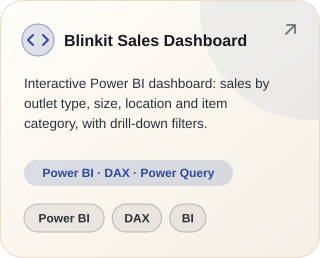</a></td>
    <td width="33%"><a href="https://github.com/narpatganwliya7/Global-Air-Pollution-Report-Dashboard">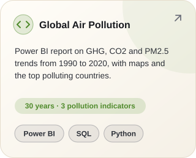</a></td>
    <td width="33%"><a href="https://github.com/narpatganwliya7/AirBnB-2025-NYC-Listing---Exploratory-Data-Analysis-using-Python">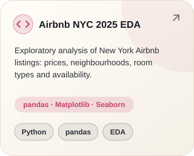</a></td>
  </tr>
</table>

  
   🎧 <b>Écoute</b> replaying its own investigation of a complaint spike: SQL, the reviews it read, the likely cause.

  

  

  

  

Fun fact: I can analyse data for hours, but still can't decide what to watch on Netflix 📊🎬

